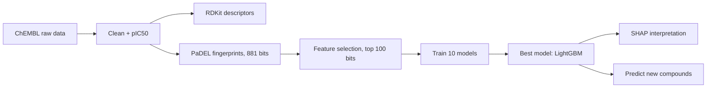

# PPARγ QSAR — Predicting IC50 from Chemical Structure

A complete, teaching-oriented QSAR (Quantitative Structure–Activity Relationship) pipeline that predicts **PPARγ inhibition potency (IC50)** directly from a molecule's SMILES string — built from ChEMBL bioactivity data and reproducing the methodology of:

> Awomuti et al., *"Predictive modelling of PPARγ IC50 inhibition by emerging pollutants using LightGBM"* (2025)

PPARγ is a nuclear receptor central to lipid metabolism and insulin sensitivity. A growing number of environmental pollutants — notably **phthalate plasticizers** — are suspected endocrine disruptors that interfere with it. Lab-testing every candidate chemical is slow and expensive; this notebook shows how to screen them computationally instead.

## What it does

| Stage | Output |
|---|---|
| Clean & standardize 1,868 raw ChEMBL records | 1,522 unique compounds, IC50 → pIC50 |
| Generate **all 202 usable RDKit descriptors**, then select a study subset | descriptor table + correlation heatmap + pair plot |
| Generate real **881-bit PubChem fingerprints** via PaDEL | full structural fingerprint table |
| Screen fingerprints (variance filter → Random Forest ranking) | 881 → 100 informative bits |
| Train & compare **10 regression models** | ranked leaderboard (R², MAE, RMSE) |
| Interpret the winning model | feature importance + SHAP |
| Predict IC50 for new, unseen compounds from an uploaded CSV | ready-to-use prediction workflow |

## Result

**LightGBM** was the best-performing model, consistent with the reference paper:

| Model | Test R² | Test MAE | Test RMSE |
|---|---|---|---|
| **LightGBM** | **0.621** | **0.557** | **0.794** |
| GradientBoosting | 0.606 | 0.608 | 0.809 |
| KNeighbors | 0.593 | 0.576 | 0.822 |
| RandomForest | 0.584 | 0.573 | 0.832 |
| XGBoost | 0.576 | 0.575 | 0.839 |
| Ridge | 0.510 | 0.694 | 0.902 |
| LinearRegression | 0.474 | 0.702 | 0.935 |
| DecisionTree | 0.408 | 0.672 | 0.992 |
| AdaBoost | 0.386 | 0.847 | 1.010 |
| ExtraTrees | 0.348 | 0.670 | 1.041 |

Trained on 1,217 compounds / evaluated on a held-out set of 305.

As a sanity check, the trained model was used to screen six real plasticizer compounds (DEHP and its metabolites) never seen during training. It correctly predicted **DEHP** — reported in the literature as inactive against PPARγ — as the weakest binder of the group, while ranking its active metabolites (MEHP, MEHHP, MEOHP) as more potent, matching published binding studies.

## Pipeline



## Repository contents

```
├── script.ipynb   # the full pipeline (Colab-ready)
├── QSAR_data.csv               # training data (ChEMBL PPARγ bioactivity)
├── query_compounds.csv         # example query compounds for prediction
└── README.md
```

## Running it

The notebook is written for **Google Colab** and is self-installing — no local environment setup needed.

1. Open `PPARg_QSAR_Notebook.ipynb` in Colab.
2. Upload `QSAR_data.csv` when prompted (Part 1).
3. Run all cells in order, top to bottom.
4. When prompted in Part 12, upload `query_compounds.csv` (or your own CSV with the same `Compound_ID, Full_Name, Smiles` columns) to get IC50 predictions for new compounds.

Each major stage downloads its own intermediate CSV (cleaned data, descriptor table, fingerprint table, selected features, model comparison, predictions) so results can be inspected or reused independently.

### Key libraries
`rdkit` · `padelpy` (PaDEL-Descriptor) · `scikit-learn` · `lightgbm` · `xgboost` · `shap` · `pandas` / `numpy` · `matplotlib` / `seaborn`

All are installed automatically inside the notebook — no `requirements.txt` needed for Colab.

## Notes on scope

- Model selection (Part 13) is left as an explicit, editable choice — any of the 10 trained models can be swapped in for prediction, not just the top performer.
- Descriptor selection (Part 3) likewise defaults to the paper's 7 Lipinski-type descriptors but can be freely extended to any of RDKit's 200+.
- This is a teaching/screening tool, not a validated predictive model for regulatory or clinical use — predictions for compounds structurally dissimilar to the training set (outside its applicability domain) should be treated with appropriate caution.

## Reference

Awomuti, A. et al. *Predictive modelling of PPARγ IC50 inhibition by emerging pollutants using LightGBM.* (2025)
